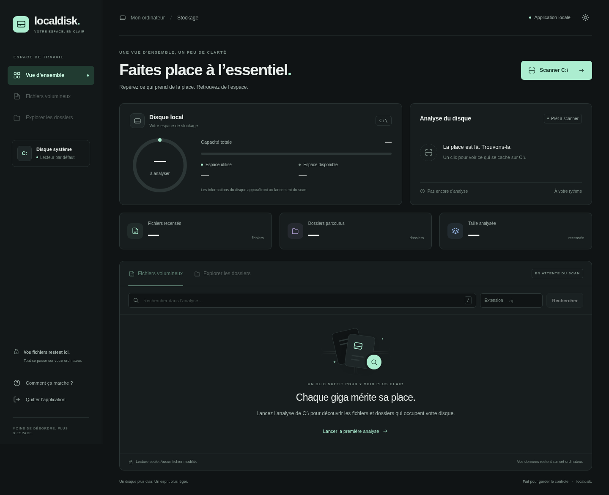
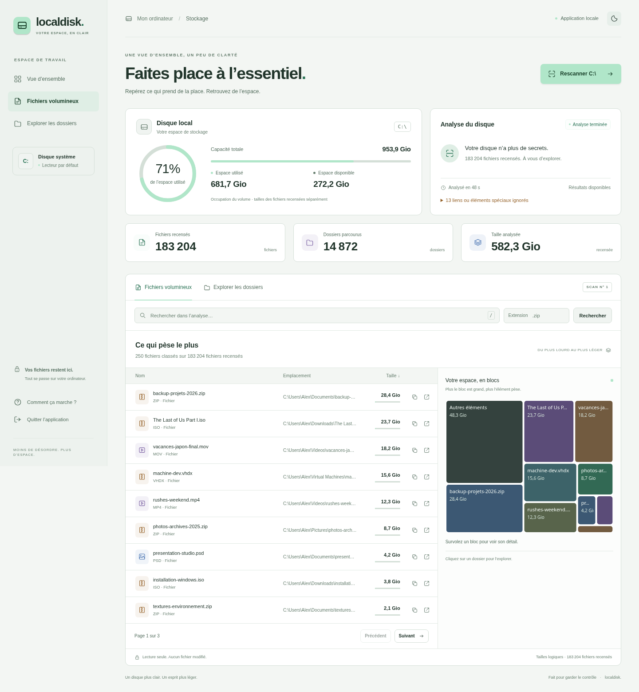

# Localdisk

Une interface locale pour voir ce qui prend de la place sur votre disque Windows. **Un clic sur « Scanner C:\ » lance l’analyse du disque système, sans choisir de dossier.**

Ce dépôt contient la nouvelle interface web à intégrer à l’application LocalDiskAnalyzer existante. Il ne contient pas encore les sources Python du serveur et du moteur d’analyse : l’archive Windows fournie pour cette refonte contenait leur version compilée. Ouvrir simplement `index.html` ne permet donc pas de scanner un disque.



## Ce qui change

- Interface en français, thème sombre avec accents menthe et thème clair mémorisé localement.
- Vue du disque, capacité, espace utilisé et disponible à partir des données du serveur.
- Compteurs de fichiers, dossiers, taille analysée et durée du scan.
- Classement des fichiers volumineux, exploration des dossiers et fil d’Ariane.
- Recherche par nom, filtre par extension et pagination.
- Carte des tailles interactive : survol pour voir la taille, clic sur un dossier pour l’explorer.
- Ouverture d’un emplacement dans l’Explorateur et copie du chemin.
- Annulation, résultats partiels et détails des accès refusés conservés.
- Adaptation aux petits écrans, aide et raccourci `/` pour la recherche.

Le scan démarre uniquement au clic. Sa cible est fixée à `C:\` dans `app.js`. L’interface n’ajoute aucun CDN ni service tiers et conserve l’authentification Bearer et le jeton local transmis dans le fragment d’URL.

## Intégrer les fichiers à votre projet

Les cinq fichiers à reprendre sont dans [`local_disk_analyzer/web/`](local_disk_analyzer/web/) : `index.html`, `style.css`, `app.js`, `treemap.js` et `favicon.svg`.

Les copier dans le dossier web correspondant du projet Python, généralement `src/local_disk_analyzer/web/` ou `local_disk_analyzer/web/`, puis reconstruire l’application avec sa commande de packaging habituelle. Aucun changement du moteur ou des routes API n’est nécessaire pour cette refonte.

### Avec Codex CLI

Dans le projet local contenant les sources Python, donner cette instruction à Codex CLI :

> Récupère les cinq fichiers de `local_disk_analyzer/web/` de la branche `codex/localdisk-interface` du dépôt `https://github.com/WaridoSann/localdiskscan`. Intègre-les dans le dossier web existant de mon projet LocalDiskAnalyzer en conservant son moteur Python et ses routes API. Lance les vérifications du projet et reconstruis la distribution Windows avec la commande de packaging déjà présente.

La branche dédiée peut aussi être récupérée avec :

```shell
git clone --branch codex/localdisk-interface https://github.com/WaridoSann/localdiskscan.git localdisk-interface
```

### Mettre à jour une distribution Windows existante

1. Fermer LocalDiskAnalyzer.
2. Sauvegarder le dossier `LocalDiskAnalyzer/_internal/local_disk_analyzer/web/` de l’application extraite.
3. Y copier les cinq fichiers de ce dépôt, en remplaçant les anciens fichiers web.
4. Relancer `LocalDiskAnalyzer/LocalDiskAnalyzer.exe` et utiliser le nouvel onglet ouvert par l’application.

Le dossier `_internal` doit rester à côté de l’exécutable. Des paramètres de version sur les fichiers web évitent de réutiliser l’ancienne interface en cache.

## Aperçus

Les captures de résultats ci-dessous utilisent des **données fictives de test**, pas un scan de votre ordinateur. Ces données ne sont pas intégrées à l’interface livrée.


<details>
<summary>Voir le thème clair</summary>



</details>

## Tests navigateur

Prérequis : Node.js 20 ou plus récent.

```shell
npm ci
npx playwright install chromium
npm test
```

Pour utiliser un Chromium déjà installé sous Linux :

```shell
CHROMIUM_PATH=/usr/bin/chromium npm test
```

Les tests démarrent un serveur statique sur `127.0.0.1:8765` et simulent les réponses de l’API locale. Ils vérifient le scan de `C:\`, la session, la progression, l’annulation, les résultats partiels, la navigation par dossier et par carte, la recherche, la pagination, l’ouverture d’un emplacement, la copie du chemin, l’aide, le thème clair, les erreurs et la fermeture. Ils vérifient aussi les noms de fichiers rendus comme texte, la géométrie de la carte et l’absence de débordement horizontal à huit largeurs entre 320 et 1920 pixels.

Les captures et le rapport de test sont enregistrés dans `test-results/`, ignoré par Git.

L’exécution du binaire Windows et l’ouverture effective de l’Explorateur n’ont pas été testées dans l’environnement Linux de préparation. Les tests navigateur ne remplacent pas un essai de la distribution sur Windows.

## Lecture des tailles

Les tailles recensées sont logiques et peuvent différer de l’occupation du volume. Les dossiers incluent leurs sous-dossiers et ne s’additionnent pas. Les erreurs de lecture et les liens ou éléments spéciaux ignorés restent signalés dans les détails du scan. L’interface ne propose aucune suppression de fichier.

## Références

[WinDirStat](https://github.com/windirstat/windirstat) et [gdu](https://github.com/dundee/gdu) ont servi de références fonctionnelles pour les classements et la navigation. Aucun code de ces dépôts n’a été repris. L’algorithme de carte de l’application fournie a été conservé, avec des ajustements de rendu et de gestion des tailles nulles.
