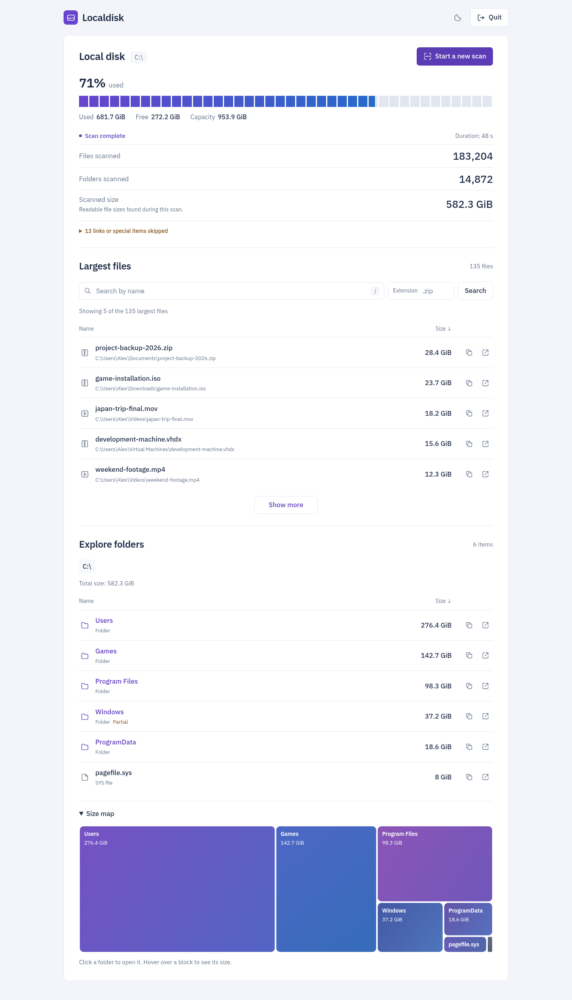

<div align="center">
  
  <h1>Localdisk</h1>
  <p>
    <a href="https://github.com/WaridoSann/localdiskscan/releases/download/windows-a751b29/LocalDiskAnalyzer-win-x64.zip"></a>
  </p>
  <p>
    
    
  </p>
</div>

Localdisk is a portable Windows tool that scans your drive to show which files and folders take up the most space. Use it to find large files, inspect folders, and open their locations in File Explorer.

## Install

1. Click **[Download for Windows 64-bit](https://github.com/WaridoSann/localdiskscan/releases/download/windows-a751b29/LocalDiskAnalyzer-win-x64.zip)** or the download button above.
2. In **Downloads**, right-click **LocalDiskAnalyzer-win-x64.zip** → **Extract all…** → **Extract**.
3. Open the extracted folder, open **LocalDiskAnalyzer**, then double-click **LocalDiskAnalyzer.exe**.

This preview is not digitally signed. Windows may display **Windows protected your PC** or **Unknown publisher**. If you obtained the download from this repository and trust it, choose **More info → Run anyway** in the SmartScreen prompt.

Your browser opens automatically. Click **Scan C:\** to start. **You do not need Git, Python, Node.js, or any server commands.**

## Preview



*The screenshot uses example data.*

<details>
<summary>Usage, permissions, and development</summary>

### Reading the results

- **Used space** is the storage Windows reports as occupied on the drive.
- **Scanned size** is the sum of readable file sizes found during the scan. It can differ from used space because of protected files, compression, sparse files, hard links, and filesystem overhead.
- **Largest files** starts with five results. Select **Show more** to load additional files. Search by name or filter by extension.
- **Explore folders** is a separate section. Click a folder or a block in the size map to navigate. Use the path above the list to go back.
- The arrow beside an item opens its location in File Explorer. The copy button copies its path.
- **Stop scan** keeps the results already found. **Start a new scan** begins another scan of `C:\`.
- The interface does not delete files. Folder sizes include their subfolders, so they overlap and should not be added together.

### Access denied

Close Localdisk, right-click **LocalDiskAnalyzer.exe**, and select **Run as administrator**. This reduces permission errors; some protected or locked Windows files may still be inaccessible. Read errors and skipped links are listed under the scan counters.

### Portable application

Keep the `_internal` folder beside `LocalDiskAnalyzer.exe`. Extract the whole ZIP before launching. Leave the application running while using its browser interface; **Quit** stops the local server.

### Development

The interface source is available in `local_disk_analyzer/web/`. The download includes the provided compiled Python engine; its Python source is not yet included in this repository.

To run the interface tests, install Node.js 20 or newer:

```shell
git clone https://github.com/WaridoSann/localdiskscan.git
cd localdiskscan
npm ci
npx playwright install chromium
npm test
```

Tests use a simulated API and write screenshots and a report to `test-results/`. They do not scan the test computer or execute the Windows application.

The release workflow packages the current interface with the unchanged base Windows runtime, verifies the archive, and publishes the ZIP, a SHA-256 checksum, and build information. To package it locally with Python 3.10 or newer:

```shell
python scripts/package_windows.py
```

This preview has not been executed on Windows in the preparation environment. Browser tests and archive checks do not replace a Windows runtime test.

### Font and references

The bundled Manrope font is licensed under the [SIL Open Font License](local_disk_analyzer/web/fonts/OFL.txt). [WinDirStat](https://github.com/windirstat/windirstat) and [gdu](https://github.com/dundee/gdu) were functional references; their code was not copied.

</details>
