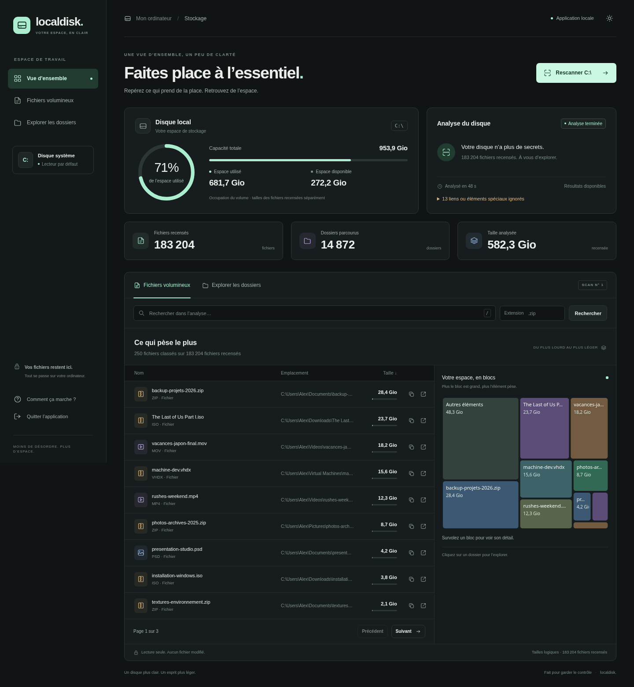

<div align="center">
  
  <h1>Localdisk</h1>
  <p>Analyse ton disque. Fais de la place.</p>
  <p>
    
    
    
    
  </p>
</div>

## Installer l’interface · Windows

À coller dans **PowerShell** :

```powershell
& {
    $localdiskApp = (Read-Host "Dossier contenant LocalDiskAnalyzer.exe").Trim().Trim('"')
    $localdiskWeb = Join-Path $localdiskApp "_internal\local_disk_analyzer\web"
    if (!(Test-Path "$localdiskApp\LocalDiskAnalyzer.exe") -or !(Test-Path $localdiskWeb)) { throw "Indique le dossier de l’application extraite." }
    $localdiskTemp = Join-Path $env:TEMP ("localdisk-" + [guid]::NewGuid())
    New-Item $localdiskTemp -ItemType Directory -ErrorAction Stop | Out-Null
    Invoke-WebRequest "https://github.com/WaridoSann/localdiskscan/archive/refs/heads/main.zip" -OutFile "$localdiskTemp\interface.zip" -ErrorAction Stop
    Expand-Archive "$localdiskTemp\interface.zip" -DestinationPath $localdiskTemp -ErrorAction Stop
    Copy-Item $localdiskWeb "$localdiskWeb.backup-$([guid]::NewGuid())" -Recurse -ErrorAction Stop
    Copy-Item "$localdiskTemp\localdiskscan-main\local_disk_analyzer\web\*" $localdiskWeb -Force -ErrorAction Stop
    Start-Process "$localdiskApp\LocalDiskAnalyzer.exe" -ErrorAction Stop
}
```

Clique sur **Scanner C:\**.

## Aperçu



<details>
<summary>Infos utiles</summary>

- Ferme LocalDiskAnalyzer avant l’installation. Une sauvegarde du dossier web est créée automatiquement.
- Ces commandes mettent à jour une application **LocalDiskAnalyzer déjà extraite**. Ce dépôt fournit l’interface ; il ne contient pas encore le moteur Python ni l’exécutable Windows.
- Aucun fichier n’est supprimé. Les tailles sont logiques ; les dossiers incluent leurs sous-dossiers.
- L’aperçu utilise des données fictives. Les tests navigateur utilisent une API simulée ; le binaire Windows reste à tester sur ton PC.

**Développement — Node.js 20+ :**

```shell
npm ci
npx playwright install chromium
npm test
```

Références : [WinDirStat](https://github.com/windirstat/windirstat) · [gdu](https://github.com/dundee/gdu).

</details>
